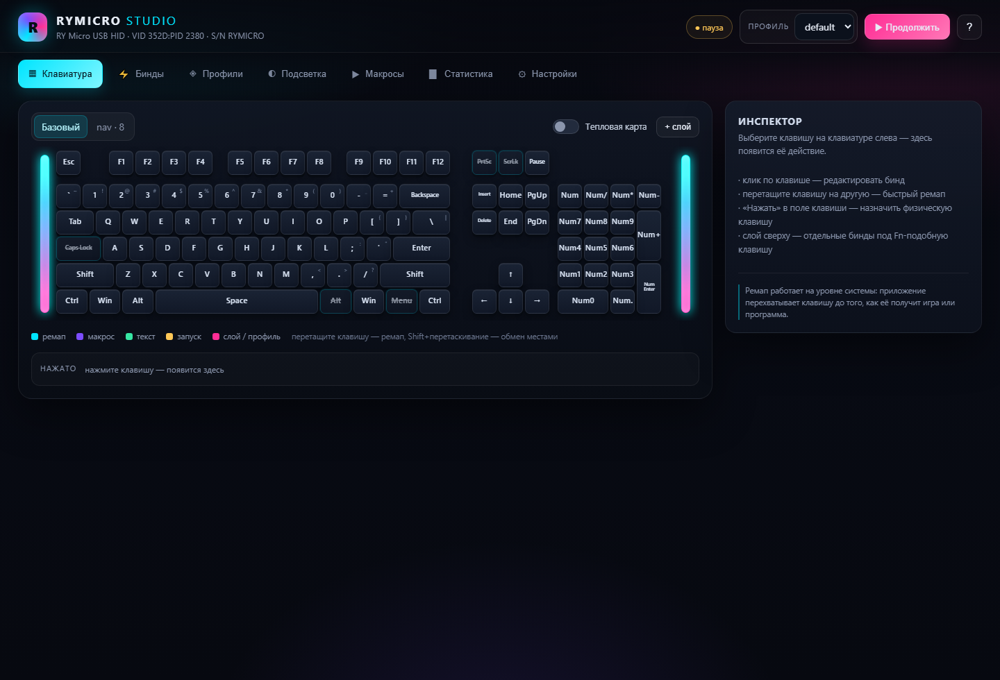
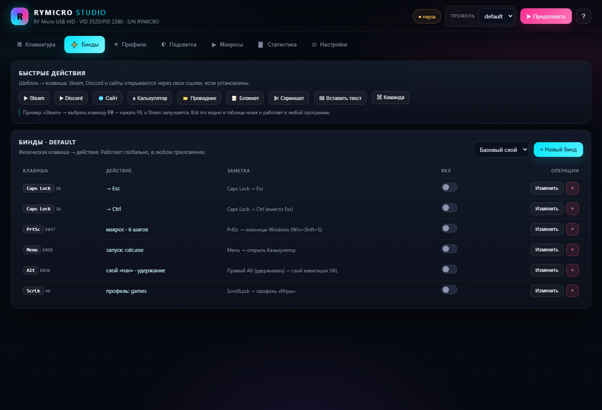
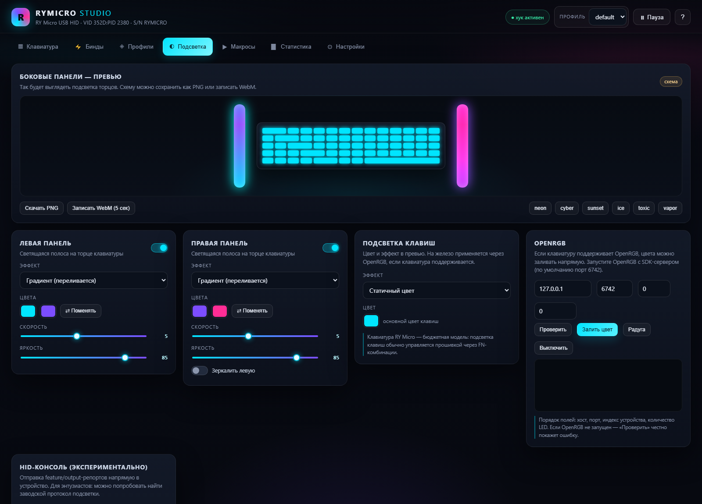
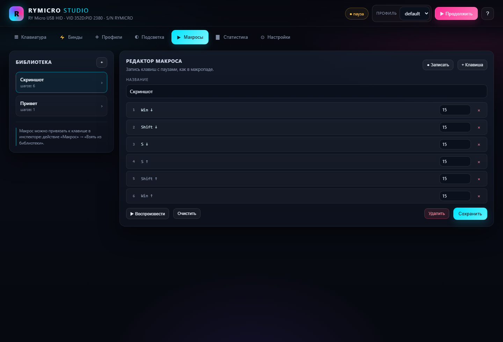
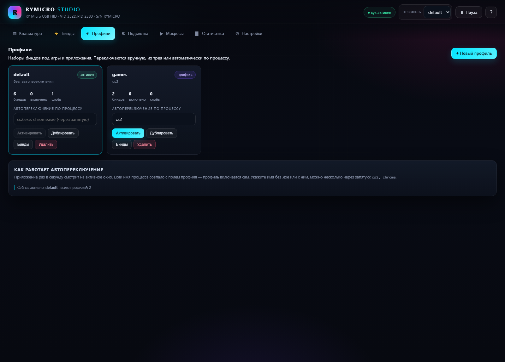
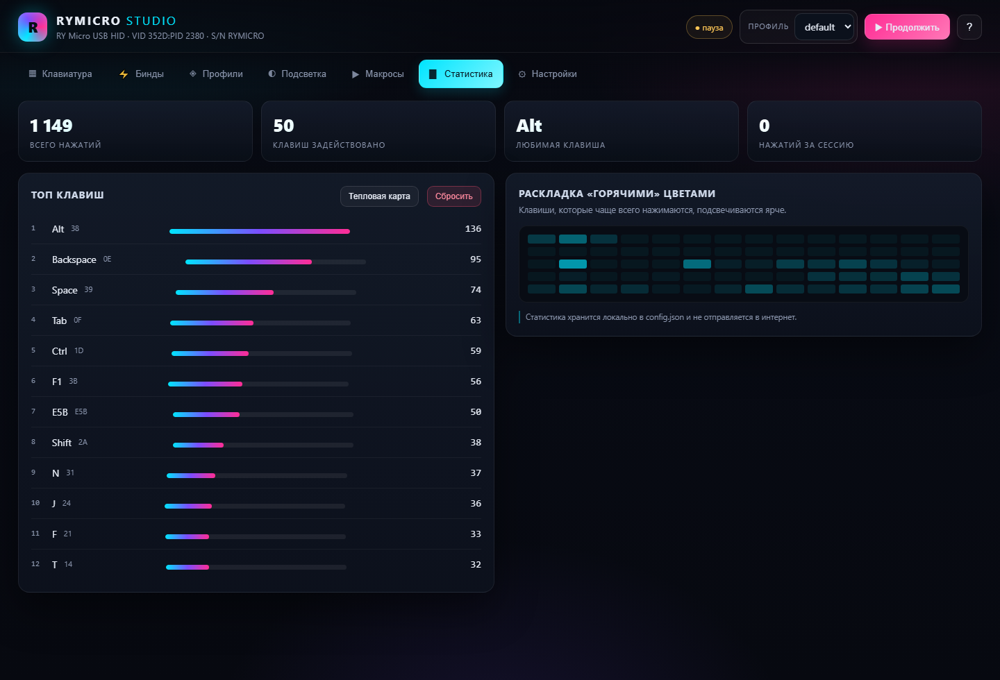
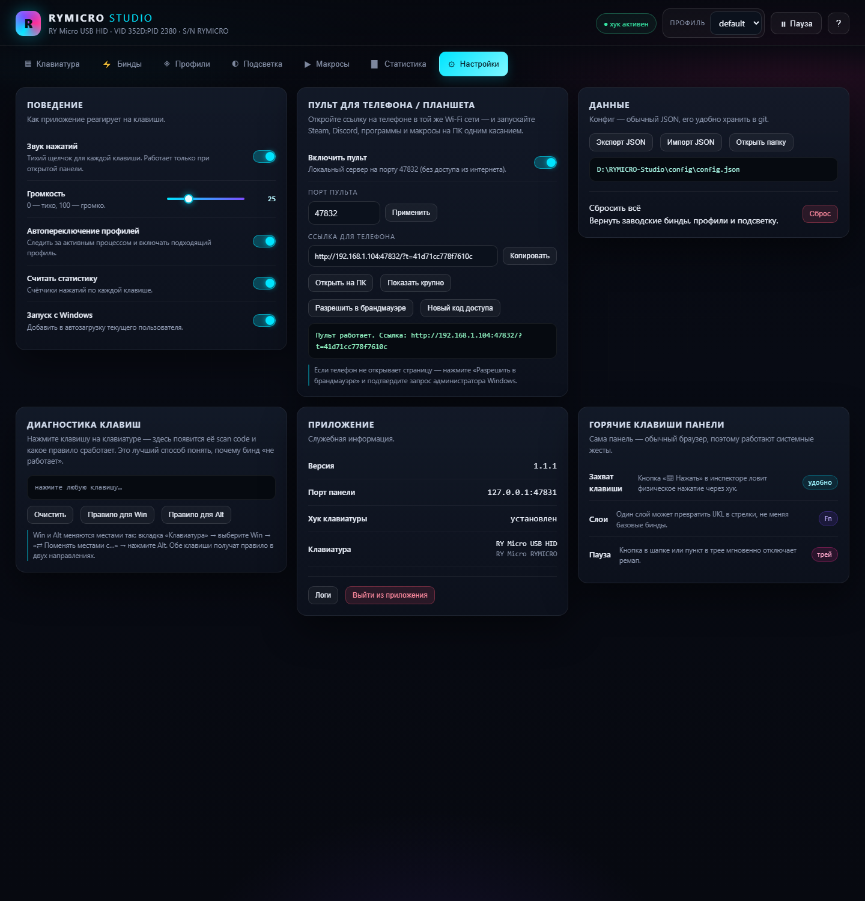

# RYMICRO Studio

**Локальная студия для клавиатуры RY Micro USB HID (`VID 352D` / `PID 2380`).**

Ремап клавиш без драйверов, слои, комбинации, макросы, профили с автопереключением, статистика нажатий и редактор подсветки боковых панелей. Всё работает локально: веб-панель поднимается на `127.0.0.1`, наружу ничего не уходит.

> Программа неофициальная и не связана с производителем клавиатуры. Она не перепрошивает устройство — она перехватывает клавиатуру в Windows и рисует схему подсветки.



## Что умеет

### Клавиатура
- Глобальный перехват клавиш через `WH_KEYBOARD_LL` — бинды работают в любой игре и программе.
- Клавиши определяются по **scan code**, а не по виртуальному коду: раскладка (RU/EN) ничего не ломает.
- Визуальная карта клавиатуры с бейджами действий и живой подсветкой нажатий.
- Быстрый ремап перетаскиванием: бросили `A` на `S` — готово.
- Захват клавиши кнопкой «⌨ Нажать» — не нужно искать код в списке.

### Действия на клавишу
| Тип | Что делает |
|---|---|
| Переназначить | клавиша → другая клавиша |
| Комбинация | клавиша → `Ctrl+C`, `Win+Shift+S` и т.п. |
| Макрос | последовательность нажатий с паузами |
| Текст | печатает заготовленный текст (поддерживается Unicode, в том числе русский) |
| Программа | запускает `.exe`, файл или URL |
| Команда | выполняет команду `cmd.exe` |
| Мультимедиа | громкость, треки, браузер, калькулятор |
| Слой | Fn-подобное поведение: удержание или переключение |
| Профиль | переключает профиль |
| Отключить | клавиша полностью игнорируется |

### Слои и профили
- Слои поверх базовой раскладки (пример: `RAlt` удерживается → `IJKL` становятся стрелками).
- Профили с автопереключением по имени процесса: запустили `cs2` — включился игровой профиль.
- Переключение из трея, из панели или биндом.

### Подсветка
- Редактор **боковых панелей**: цвет, второй цвет, эффекты `static / gradient / breathing / rainbow / wave / reactive`, скорость, яркость.
- Живое превью клавиатуры с боковыми полосами.
- 6 готовых пресетов: `neon`, `cyber`, `sunset`, `ice`, `toxic`, `vapor`.
- **Экспорт схемы**: PNG и 5-секундный WebM.
- **OpenRGB SDK**: если клавиатуру поддерживает OpenRGB — можно заливать цвет прямо в железо (проверка, Custom-режим, обновление LED).
- **HID-консоль**: отправка feature/output-репортов и сохранение удачных пакетов — для тех, кто хочет найти заводской протокол.
- Честное предупреждение в интерфейсе: у бюджетных моделей подсветка обычно управляется прошивкой через FN. Подробнее — [docs/LIGHTING.md](docs/LIGHTING.md).

### Статистика и мелочи
- Счётчики нажатий по каждой клавише, топ-12, тепловая карта.
- Звук нажатий (синтезируется в браузере, без файлов).
- Запуск с Windows, один экземпляр, трей-меню, пауза одной кнопкой.
- Конфиг — обычный JSON, экспорт/импорт, сброс к заводским настройкам.

## Скриншоты

| Бинды | Подсветка |
|---|---|
|  |  |

| Макросы | Профили |
|---|---|
|  |  |

| Статистика | Настройки |
|---|---|
|  |  |

## Требования

- Windows 10/11 (x64).
- .NET Framework 4.8 — есть в системе по умолчанию.
- Браузер для панели (Edge/Chrome/Firefox).
- Никаких пакетов и установок: приложение собирается встроенным компилятором C#.

## Быстрый старт

Готовая сборка: [RYMICRO-Studio-1.0.0.zip](https://github.com/gemerte/rymicro-studio/releases/latest) — распакуйте и запустите `start.cmd`.

Или соберите сами:

```powershell
# сборка
powershell -NoProfile -ExecutionPolicy Bypass -File .\build.ps1

# запуск (панель откроется сама)
.\start.cmd
```

Или просто двойной клик по `start.cmd` — он соберёт `.exe`, если его ещё нет, и запустит приложение.

После запуска:
1. В трее появляется значок **R**.
2. Открывается браузер с панелью (адрес с токеном).
3. Если вкладка закрылась — двойной клик по значку в трее или пункт «Открыть панель».

Адрес и токен также лежат в `config/.port` в виде `port|token`.

## Как это устроено

```
RYMICRO Studio.exe   — приложение (WinForms + HttpListener + хук)
web/                 — панель: статический HTML/CSS/JS, без сборки
config/config.json   — бинды, профили, макросы, подсветка, статистика
config/.port         — порт панели и токен доступа
logs/app.log         — журнал
src/                 — исходники C#
```

Запросы к `/api/*` требуют токен: заголовок `X-Auth` или параметр `?t=`. Сервер слушает только `127.0.0.1`.

### API (кратко)

| Метод | Назначение |
|---|---|
| `GET /api/state` | полное состояние: конфиг, клавиши, устройство, runtime |
| `GET /api/event` | SSE-поток: нажатия, логи, изменения состояния |
| `POST /api/rule` | `upsert` / `delete` / `toggle` бинда |
| `POST /api/profile`, `profile-save`, `profile-delete` | профили |
| `POST /api/layer-add`, `layer-delete` | слои |
| `POST /api/lighting` | сохранить схему подсветки |
| `POST /api/openrgb` | `probe` / `apply` / `rainbow` / `off` |
| `POST /api/hid-send` | HID feature/output-репорт |
| `POST /api/suspend`, `pause` | временно отключить перехват |
| `GET /api/logs?tail=200` | хвост журнала |

## Сборка из исходников

```powershell
powershell -NoProfile -ExecutionPolicy Bypass -File .\build.ps1            # windowless
powershell -NoProfile -ExecutionPolicy Bypass -File .\build.ps1 -DebugConsole  # с консолью
```

Скрипт использует `C:\Windows\Microsoft.NET\Framework64\v4.0.30319\csc.exe` и компилирует все файлы из `src/` в `RYMICRO Studio.exe`. Внешние зависимости не нужны.

## Горячие клавиши

Панель — обычная веб-страница, поэтому работают системные жесты браузера. Внутри приложения:

- `Esc` — отмена захвата клавиши или закрытие окна.
- Кнопка «⏸ Пауза» в шапке — мгновенно отключает ремап (хук остаётся, но ничего не подменяет).
- Пункт «Пауза» в трее делает то же самое.

Подробнее про FN-комбинации самой клавиатуры — [docs/HOTKEYS.md](docs/HOTKEYS.md).

## Ограничения

- Подсветка **клавиш** у RY Micro управляется прошивкой. Программа не может менять её без поддержки со стороны железа; для этого есть OpenRGB и HID-консоль.
- Ремап работает, пока приложение запущено. Для «всегда включено» есть автозапуск с Windows.
- Некоторые античиты относятся к низкоуровневым хукам настороженно. Если игра блокирует ввод — поставьте паузу или закройте приложение.
- Перехват идёт на уровне пользовательской сессии: экран блокировки и UAC-запросы он не обслуживает.

## Лицензия

MIT — см. [LICENSE](LICENSE).
